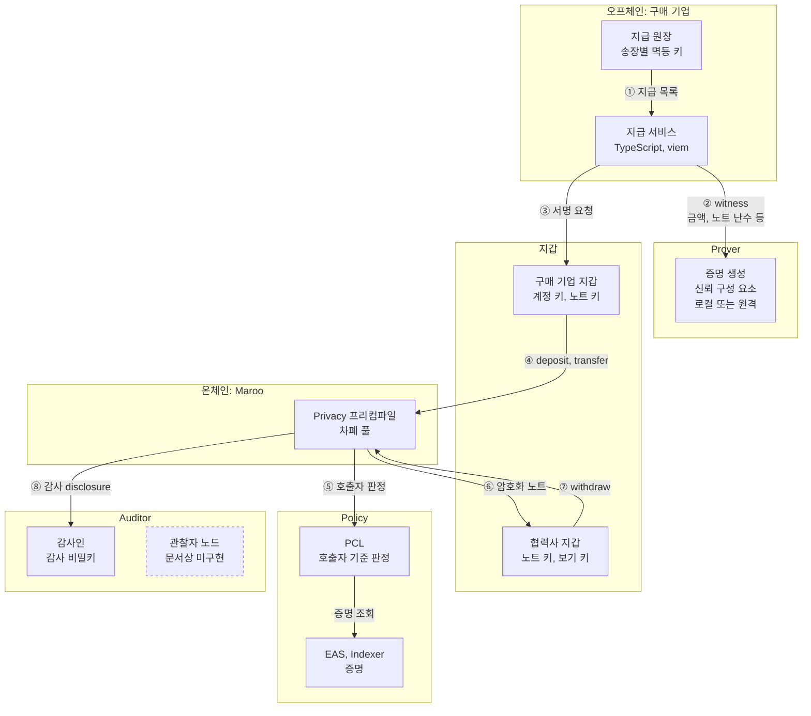
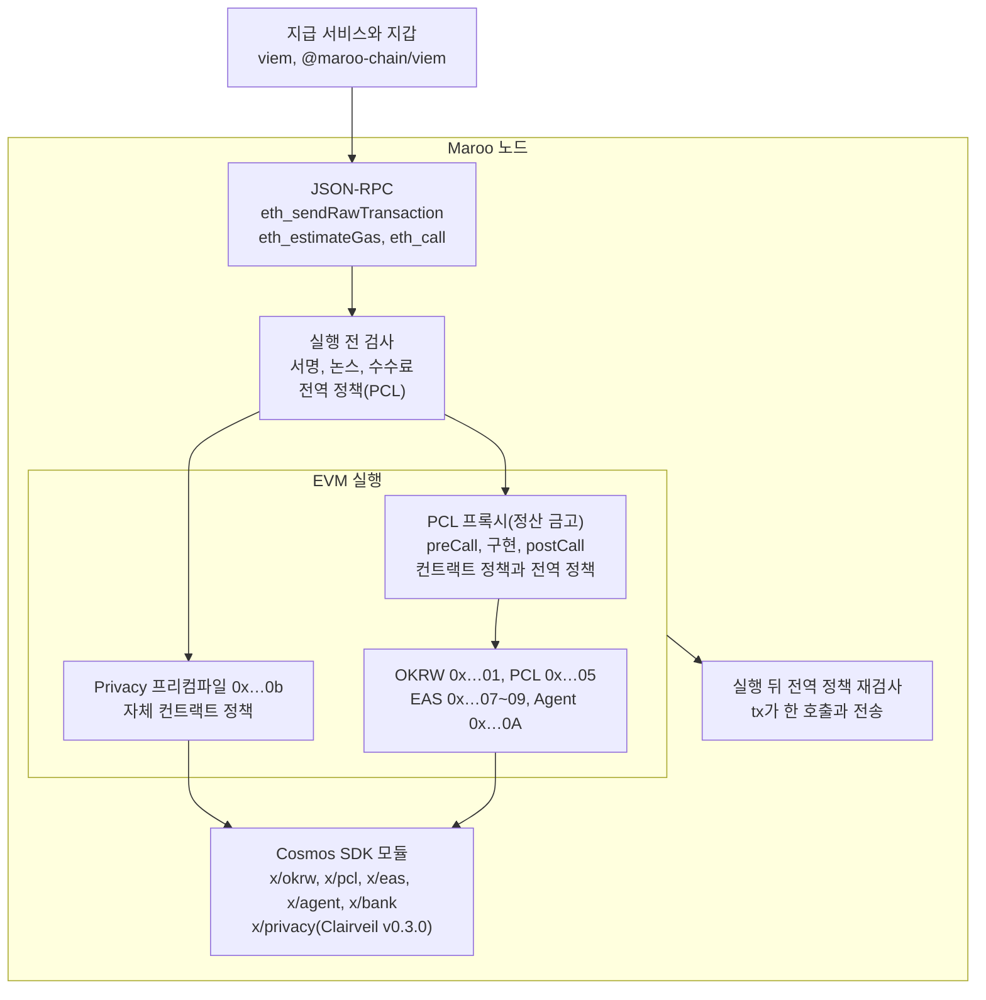
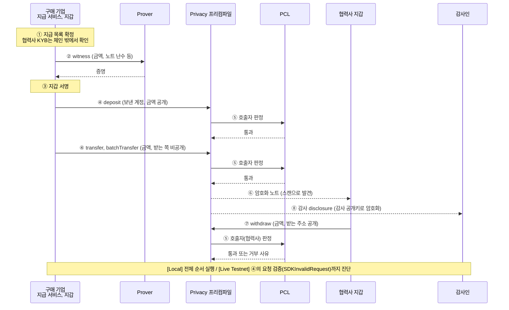
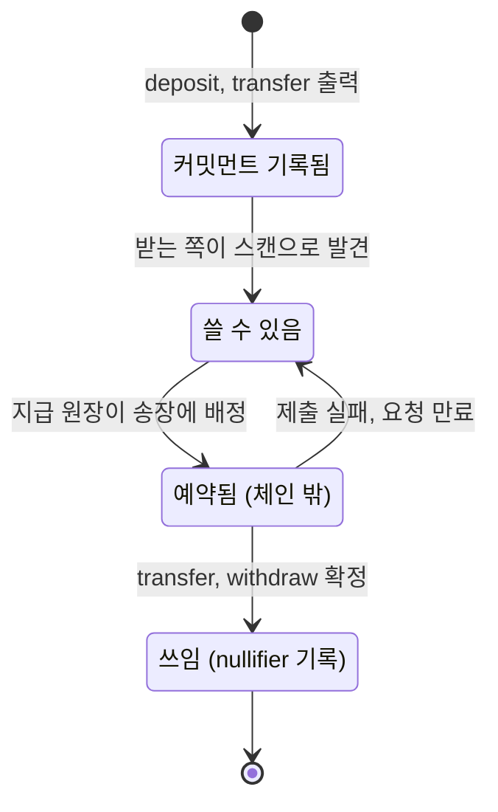

# 기관 연동 가이드: Maroo에서 협력사 대금을 비공개로 정산하기

- 기준: Maroo Docs(2026-09-25 확인, 2026-10-23 다시 대조), Maroo 테스트넷(chain ID 450815, 2026-09-26 확인, 노드 판과 설정은 2026-10-23 확인), Clairveil v0.4.0 [`ca85b027`](https://github.com/DELIGHT-LABS/clairveil/tree/ca85b02708fdd75259d4d2ee2d671c21198cec69), `@maroo-chain/contracts` 0.0.9
- 표시: 문서에서 확인한 사실은 `[Docs Only]`, 직접 실행해 확인한 사실은 `[Live Testnet]`(Maroo 테스트넷)과 `[Local]`(Clairveil 로컬 체인)로, 코드와 패키지를 직접 대조한 결과는 `[코드 대조]`로 적습니다. 이 레포가 제안하는 설계와 절차는 "권고"로 따로 적습니다.
- 함께 보는 문서: [실행 레시피](runnable-recipe.md), [기관 FAQ](faq.md), [문서 개선 노트](documentation-improvement-notes.md)

## 0. 이 문서를 읽는 사람

이 가이드는 대기업 구매·재무 조직, 또는 그 지급 시스템을 운영하는 은행과 핀테크의 시니어 백엔드 엔지니어를 위해 썼습니다. 이 조직은 협력사 수백 곳에 매달 대금을 계좌이체나 상생결제로 치르고, 지급 기록은 ERP와 은행 전산에 남습니다. 원화 스테이블코인 정산을 검토하라는 요청을 받았고, 4\~8주 PoC로 가능성을 확인한 뒤 보안, 컴플라이언스, 운영, 제품 팀에 결과를 설명해야 합니다. 개발 환경은 TypeScript 백엔드와 EVM 도구(viem, Foundry)입니다. 공개 체인에 대금을 올리면 협력사별 금액과 거래 관계가 누구에게나 보이는데, 단가와 거래량과 거래처 목록은 회사가 영업비밀로 관리하는 정보입니다([부정경쟁방지법 제2조](https://casenote.kr/법령/부정경쟁방지_및_영업비밀보호에_관한_법률/제2조)). PoC에서 판단할 것은 이 정보를 숨긴 채 감사인과 규제기관의 확인 요건을 맞출 수 있는지, 그리고 지금 Maroo에서 그 구조를 어디까지 직접 검증할 수 있는지입니다. 처음 보는 용어(차폐 노트, prover, disclosure, nullifier 등)는 [부록 A](#부록-a-용어)에 있습니다.

### 이 가이드가 답하는 질문

도입을 검토하는 엔지니어가 PoC 전에 답해야 하는 질문과 그 답을 모았습니다. 마지막 열은 근거와 자세한 내용이 있는 절입니다.

| 질문 | 답 | 자세히 |
| --- | --- | --- |
| 어떤 문제를 푸는 기술인가 | 협력사 대금을 공개 체인으로 치르면서 협력사별 금액과 거래 관계를 제3자에게서 가리고, 감사인과 규제기관은 정해진 키와 절차로 확인하게 합니다. 가리는 일은 Privacy 프리컴파일의 차폐 풀이, 자격 확인은 PCL 정책이 맡습니다. | 1절, 3절 |
| Maroo가 외부 개발자에게 주는 인터페이스는 무엇인가 | EVM JSON-RPC, OKRW·PCL·EAS·Agent·Privacy 프리컴파일, ABI 패키지(`@maroo-chain/contracts`)와 공식 SDK(`@maroo-chain/viem`), 노드 정보와 모듈 설정, Clairveil 차폐 상태(회로 설정, 트리 상태, Merkle 경로, nullifier, 자산 등록)를 읽는 Cosmos REST입니다. 테스트넷 검증 키와 짝인 proving 재료는 없습니다. | 1절, 6절 |
| Clairveil과 Maroo `x/privacy`는 어떤 관계인가 | 테스트넷 노드가 빌드 의존성으로 Clairveil v0.3.0을 밝히고, Maroo `IPrivacy` ABI는 ClairveilJS의 EVM Privacy 계약과 같습니다. 그래도 이 레포가 로컬에서 만든 증명은 검증 키와 체인 도메인이 달라 Maroo에서 통과하지 못합니다. | 1절 |
| OKRW, PCL, Privacy는 한 번의 지급에서 어떻게 이어지는가 | 구매 기업이 OKRW를 Privacy 프리컴파일에 예치하면 차폐 노트가 되고, 지급과 인출은 노트를 쓰고 새로 만듭니다. PCL은 이 호출마다 호출한 계정을 평가합니다. | 2절 |
| 누가 무엇을 볼 수 있는가 | 제3자는 예치 금액, 인출 금액과 받는 주소, 지급한 계정과 지급 건수를 봅니다. 지급 금액과 받는 협력사는 받는 협력사, 보낸 기업, 감사 키를 가진 주체만 봅니다. Maroo가 말하는 Verifiable Privacy의 네 시야 가운데 운영자 시야는 금액만 받는 정산 대행사로(`pnpm a:local --operator`), 통제된 열람은 감사 키를 세 역할의 몫으로 나눈 시제품(`pnpm a:audit-access`)으로 만들었습니다. | 3절 |
| 어떤 키와 서비스가 신뢰 경계에 드는가 | 지갑의 노트 키, 증명 요청을 받는 prover, 감사 비밀키, KYB 발급 키, PCL 정책 관리 권한, 컨트랙트 업그레이드 권한입니다. | 4절 |
| 레퍼런스와 프로덕션 사이에 무엇이 남는가 | 노트 하나에 약 18.45 OKRW인 금액 상한, 외부 감사를 받지 않은 참조 구현, 체인에 아직 없는 규제기관 열람 기능, 외부 개발자에게 공개되지 않은 proving 재료입니다. | 8절 |

### 지금 되는 것과 남은 것

이 가이드가 다루는 범위마다 어디까지 실행했는지 모았습니다. 라벨 열은 증거의 종류이고, 근거 열은 실행 기록 파일입니다.

| 범위 | 상태 | 라벨 | 근거 |
| --- | --- | --- | --- |
| Privacy 프리컴파일의 정책, 요구 증명, 요청 모양 조회 | 실행함 | `[Live Testnet]` | [조회 기록](evidence/live/inspect-privacy-boundary-20261023T071335Z.json) |
| Privacy 예치가 처음 막히는 층 진단 | 전역 정책 거부 없이 요청 검증(`SDKInvalidRequest`)에서 막힘 | `[Live Testnet]` eth_call과 eth_estimateGas, 거부 경로 증거 | [진단 기록](evidence/live/probe-first-failure-20261023T071333Z.json) |
| 보내기 전 정책 검사 방법 | PCL 프록시를 거치지 않는 OKRW 이체는 `eth_call`에서 전역 정책 거부가 나오지 않고 `eth_estimateGas`에서 나옵니다. PCL 프록시 호출은 두 방법 모두 거부합니다 | `[Live Testnet]` | [비교 기록](evidence/live/probe-global-compare-20261023T042452Z.json), [faucet 기록](evidence/live/probe-global-policy-20260925T190841Z.json) |
| OKRW 지급과 KYB 관문을 건 정산 금고 | 실행함. 증명 없음, 색인 전, 폐기 뒤 청구는 거부되고 색인 뒤 청구는 통과. 정책 관리자와 업그레이드 권한이 다른 주소 | `[Live Testnet]` 상태 변경 tx 18건 | [금고 흐름 기록](evidence/live/pcl-kyb-gate-20260926T000141Z.json) |
| 차폐 정산 전체(예치, 일괄 지급, 스캔, 해독, 인출) | 실행함 | `[Local]` Clairveil v0.4.0 | [로컬 실행 기록](evidence/local/vendor-settlement-20260925T181924Z.md) |
| 테스트넷에서 유효한 Privacy 상태 변경 | 외부에서 만들 수 없습니다. 테스트넷 검증 키와 짝인 proving 키나 prover가 공개되지 않았습니다. 차폐 상태 조회 경로는 2026-10-23 판 문서가 Cosmos REST로 적은 주소에서 응답하고, 공식 SDK의 예치 준비가 그 주소로 증명 공급자까지 갑니다 | `[Live Testnet]`, `[Docs Only]` | 6절, [감시 기록](evidence/live/watch-privacy/2026-10-23.json) |
| Privacy 컨트랙트 정책(4층) | 공개된 성공 예치의 calldata를 본인 인증 증명이 없는 지갑에서 부르면 `EasNoAttestationReceived`로 막히고, 증명이 있는 지갑은 정책을 지납니다 | `[Live Testnet]` eth_call과 eth_estimateGas | 6절, [공개 tx 시뮬레이션 기록](evidence/live/probe-public-privacy-20261023T064628Z.json) |
| Privacy 준비 상태 감시 | `pnpm a:watch-privacy`가 조회 경로, proving 재료, 4층 시험, SDK 예치 준비, Privacy tx 수, 문서 변경, Clairveil 릴리스를 기록합니다. GitHub Actions가 하루 한 번 돌립니다 | `[Live Testnet]` 조회 | [첫 기록](evidence/live/watch-privacy/2026-10-23.json) |
| 테스트넷 노드와 Clairveil의 관계 | 노드(`marood` 0.10.0)가 빌드 의존성으로 `github.com/DELIGHT-LABS/clairveil v0.3.0`을 밝힙니다 | `[Live Testnet]` | [노드 정보 기록](evidence/live/chain-info-20261023T045537Z.json) |
| 실패한 tx의 사유와 걸린 정책 판별 | `pnpm explain`이 오류 선택자로 계열을 정하고 전역 정책인지 컨트랙트 정책인지 가립니다. 이 레포가 겪은 실패 다섯 계열을 모두 맞게 풀었습니다 | `[Live Testnet]` 조회 | [해석 기록](evidence/live/explain-examples-20261023T071511Z.json) |
| 규제기관의 관찰자 노드 열람 | 체인에 구현되지 않았습니다 | `[Docs Only]` | [검증 가능한 프라이버시](https://docs.maroo.io/concepts/privacy/verifiable-privacy/) |
| 감사 키를 나눠 맡긴 통제된 열람(3절 시제품) | 실행함. 두 역할이 승인한 tx의 감사 공개만 열렸고, 요청, 승인, 열람의 해시가 EAS 증명 네 건으로 남았습니다 | 해독 `[Local]`, 기록 `[Live Testnet]` | [열람 기록](evidence/live/audit-access-20261023T054254Z.json) |

## 1. 한 장으로 보는 공급업체 정산

결론: 금액과 받는 협력사를 숨길 대금은 Privacy 프리컴파일의 차폐 경로로, 받는 순간 자격을 체인이 확인해야 할 대금은 PCL 정책을 건 금고의 투명 경로로 나눕니다. Maroo 테스트넷에서는 투명 경로를 끝까지 실행했고, 차폐 경로는 Clairveil 로컬에서 실행했습니다.

정산은 두 경로로 나눠 설계합니다. 금액과 받는 협력사를 숨기는 차폐 경로는 Privacy 프리컴파일을 씁니다. 받는 순간 협력사 자격을 체인이 직접 확인해야 하는 대금은 투명 경로로 보내고, PCL 정책을 건 정산 금고가 청구를 받습니다. 아래 그림은 차폐 경로의 구성 요소와 경계를 보여 주고, 투명 경로는 이 절 끝의 표에 있습니다.

### 여섯 경계

정산이 지나는 여섯 경계마다 구성 요소와 하는 일, 경계가 가진 비밀을 모았습니다. 마지막 열은 근거가 되는 문서나 기록입니다.

| 경계 | 구성 요소 | 하는 일 | 쥐고 있는 비밀 | 근거 |
| --- | --- | --- | --- | --- |
| 오프체인 | 지급 원장, 지급 서비스 | 송장을 지급 목록으로 묶고, 송장마다 멱등 키와 상태를 두고, 체인 결과와 대사합니다 | 송장 내용, 협력사 목록 | 권고 |
| 지갑 | 구매 기업 지갑, 협력사 지갑 | 요청에 서명하고, 체인의 암호화 노트를 스캔해 자기 노트를 찾고, disclosure를 풉니다 | 계정 키, 노트 키(지출, 보기) | `[Docs Only]` [Clairveil 위협 모델](https://github.com/DELIGHT-LABS/clairveil/blob/ca85b02708fdd75259d4d2ee2d671c21198cec69/docs/clairveil-threat-model.md), `[Local]` |
| Prover | 증명 생성 구성 요소 | witness(금액, 노트 난수, Merkle 경로, nullifier 등)를 받아 Groth16 증명을 만듭니다 | 요청마다 받는 witness | `[Docs Only]` [Clairveil 운영 가이드](https://github.com/DELIGHT-LABS/clairveil/blob/ca85b02708fdd75259d4d2ee2d671c21198cec69/docs/clairveil-operations-guide.md) |
| 온체인 | Privacy 프리컴파일 `0x…0b`, OKRW | 증명을 검증하고 커밋먼트와 nullifier를 기록하며, 예치된 OKRW를 보관합니다 | 없음. 커밋먼트, nullifier, 암호문만 기록합니다 | `[Docs Only]` [프라이버시 프리컴파일](https://docs.maroo.io/concepts/privacy/privacy-precompile-overview/) |
| Policy | PCL `0x…05`, EAS `0x…07`, Indexer `0x…08` | 상태를 바꾸는 호출마다 호출자를 전역 정책과 컨트랙트 정책으로 평가합니다 | 없음 | `[Docs Only]` [정책 인식 프리컴파일](https://docs.maroo.io/concepts/privacy/privacy-policy-aware-precompile/), `[Live Testnet]` 주소 |
| Auditor | 감사인, 관찰자 노드 | 모든 차폐 이동에 붙는 감사 disclosure를 풉니다. 관찰자 노드 열람은 체인에 아직 없습니다 | 감사 epoch 비밀키 | `[Local]`, `[Docs Only]` |

### Maroo가 외부 개발자에게 주는 인터페이스

Maroo가 개발자에게 공개한 인터페이스를 모았습니다. 위치 열은 주소나 패키지 이름이고, 셋째 열은 이 정산에서 그 인터페이스를 쓰는 곳입니다.

| 인터페이스 | 위치 | 이 정산에서 쓰는 곳 | 라벨 |
| --- | --- | --- | --- |
| EVM JSON-RPC | `https://rpc-testnet.maroo.io`, chain ID 450815 | 모든 호출과 조회 | `[Live Testnet]` |
| OKRW 프리컴파일과 네이티브 잔액 | `0x1000…0001`, 테스트넷 denom `atokrw` | 대금, 가스, 금고 입금, Privacy 예치 금액 | `[Live Testnet]` |
| PCL 프리컴파일 | `0x1000…0005` | 전역 정책, Privacy 정책 조회, 금고 프록시 배포(`deployPclProxy`)와 정책 바인딩 | `[Live Testnet]` |
| EAS, SchemaRegistry, Indexer | `0x1000…0009`의 `getParams()`로 찾습니다 | KYB 스키마 등록, 증명 발급과 폐기, 색인 | `[Live Testnet]` |
| Privacy 프리컴파일 | `0x1000…000b` | 예치, 지급, 일괄 지급, 인출과 각각의 `*WithAuthorization` 변형. 조회 함수는 없습니다 | `[Docs Only]`, 호출은 `[Live Testnet]` eth_call |
| ABI 패키지 | `@maroo-chain/contracts` 0.0.9 | `IPcl`, `IPrivacy` ABI | `[Live Testnet]` 호출에 사용 |
| 공식 TypeScript SDK | `@maroo-chain/viem` 0.4.0 (npm 패키지. 2026-09-26 판 Maroo Docs에는 나오지 않았고, 2026-10-23 판은 ERC-8004 ABI의 출처로만 적습니다) | PCL 정책 해석(`PolicySet.decode`), 금고 프록시 배포(`pcl.deployPclProxy`)와 정책 바인딩(`policy.eas`, `pcl.changeContractPolicies`). Privacy는 ABI와 주소만 있고 증명 생성과 상태 조회는 없습니다 | 정책 해석은 `[Live Testnet]` 정책에 사용. 배포와 바인딩은 직접 인코딩과 calldata가 같고 `[코드 대조]` (`pnpm test:unit`), 새 지갑으로 돌린 금고 흐름 전체가 SDK 코드로 통과 `[Live Testnet]` ([기록](evidence/live/pcl-kyb-gate-20260926T052641Z.json)) |
| 탐색기 | `https://explorer-testnet.maroo.io` (Blockscout) | tx 확인, 이벤트 조회 | `[Live Testnet]` |
| Cosmos REST | `https://api-testnet.maroo.io`, Cosmos chain-id `maroo-testnet-1`. 둘 다 2026-10-23 판 [테스트넷 접근](https://docs.maroo.io/resources/network/testnet-access/) 페이지에 있습니다 | 노드 판과 빌드 의존성, 수수료 설정(`min_gas_multiplier`), EVM 설정 조회 | `[Live Testnet]` [노드 정보 기록](evidence/live/chain-info-20261023T045537Z.json), 재현: `pnpm a:chain-info` |

Maroo Docs에는 현재 테스트넷 verifier와 맞는 proving 산출물과 prover 엔드포인트가 없습니다. 2026-10-23 판에서 「회로」, 「검증 키」, 「prover」를 찾아도 이 재료를 적은 문장은 없었습니다. `[Docs Only]` 차폐 상태를 읽는 조회 경로는 문서에 따로 적혀 있지 않습니다. 다만 같은 판 테스트넷 접근 페이지가 Cosmos REST로 적은 `https://api-testnet.maroo.io`에서 Clairveil `x/privacy` 조회(회로 설정, 트리 상태, Merkle 경로, nullifier, 이벤트, 자산 등록)가 응답합니다. 2026-09-26 판은 이 주소를 Indexer로 적었고, 이 레포는 제출 때 이 주소에서 Clairveil 조회를 시험하지 않았습니다. `[Live Testnet]` [감시 기록](evidence/live/watch-privacy/2026-10-23.json) 그래서 외부에서 유효한 Privacy tx를 만들지 못하게 막는 것은 proving 재료 하나로 좁혀집니다(6절).

### Clairveil과 Maroo `x/privacy`의 관계

결론: Maroo 테스트넷의 Privacy는 Clairveil 계열입니다. 노드가 Clairveil v0.3.0에 의존하고 ABI가 같습니다. 그러나 증명은 체인마다 다른 검증 키와 체인 도메인에 묶여, 이 레포가 로컬에서 만든 증명은 Maroo에서 통과하지 못합니다.

Clairveil은 Cosmos SDK 체인에 차폐 풀을 넣는 공개 참조 구현입니다. Maroo Docs에는 Clairveil이 나오지 않고 Clairveil 레포에도 Maroo가 나오지 않아, 이 레포는 아래 연결 고리를 직접 대조했습니다.

0. 테스트넷 노드의 Cosmos REST 노드 정보(`/cosmos/base/tendermint/v1beta1/node_info`)가 앱 `marood` 0.10.0의 빌드 의존성으로 `github.com/DELIGHT-LABS/clairveil v0.3.0`을 밝힙니다. 2026-10-23에 처음 확인했고, 제출 때는 이 근거가 없었습니다. `[Live Testnet]` [노드 정보 기록](evidence/live/chain-info-20261023T045537Z.json), 재현: `pnpm a:chain-info`
1. Maroo `IPrivacy` ABI의 함수 9개와 이벤트 5개는 ClairveilJS가 들고 있는 정식 EVM Privacy 계약 v0.3.1과 함수 선택자, 이벤트 서명, 정규화한 ABI의 sha256(`ee29aa6a…cb31b`)까지 같습니다. ClairveilJS의 EVM 전송 모듈은 이 계약을 가진 체인을 대상으로 만들어졌습니다. `[코드 대조]` [대조 기록](evidence/code/abi-compare-20260926T040350Z.json), 재현: `pnpm a:abi-compare`
2. Maroo `IPrivacy`의 전송 요청 필드 17개는 Clairveil v0.4.0 `MsgTransfer`의 18개에서 `creator` 하나를 뺀 것과 같습니다. EVM에서는 `msg.sender`가 `creator` 자리를 대신합니다. `[Live Testnet]` ABI 대조, [조회 기록](evidence/live/inspect-privacy-boundary-20261023T071335Z.json)
3. clairveil-samples의 EVM 설정 예시가 쓰는 Privacy 프리컴파일 주소 `0x1000…000b`가 Maroo 테스트넷 주소와 같습니다. `[Docs Only]` [`.env.evm.example`](https://github.com/DELIGHT-LABS/clairveil-samples/blob/8321dedc231372679cfbea4314d080ecaea2e3f5/.env.evm.example)
4. Clairveil v0.5.x의 전송 메시지(`privacy/v2`)는 출력마다 `outputs` 항목을 두고 감사 정보를 `audit` 하나로 묶는 모양으로 바뀌었습니다. Maroo 테스트넷 ABI는 v0.4.0 모양과 맞습니다. `[Docs Only]` [v0.5.1 `tx.proto`](https://github.com/DELIGHT-LABS/clairveil/blob/v0.5.1/proto/clairveil/privacy/v2/tx.proto), `[Live Testnet]` ABI 대조

#### 로컬 증명이 Maroo에서 통과하지 못하는 이유

체인은 증명을 검사할 때 공개 입력을 자기 상태에서 채워 넣고, 하나라도 증명을 만들 때의 값과 다르면 검증이 실패합니다. 아래 표는 Clairveil 회로의 공개 입력마다 체인이 그 값을 어디서 가져오는지, 이 레포의 로컬 체인과 Maroo 테스트넷에서 그 값이 어떻게 다른지를 모았습니다. 회로의 공개 입력은 Maroo 노드가 쓰는 v0.3.0과 이 레포가 쓰는 v0.4.0이 같습니다(2026-10-23 대조). `[코드 대조]`

| 값 | 묶이는 증명 | 체인이 가져오는 곳 | 이 레포의 로컬 체인 | Maroo 테스트넷 |
| --- | --- | --- | --- | --- |
| 검증 키 | 예치, 전송, 인출 | 체인 설정의 회로 산출물 | `clairveil-setup`이 만든 키. setup은 돌 때마다 새 키를 만듭니다([`groth16.Setup`](https://github.com/DELIGHT-LABS/clairveil/blob/ca85b02708fdd75259d4d2ee2d671c21198cec69/cmd/clairveil-setup/main.go#L305)) | Cosmos REST의 회로 설정(`circuit_config`)에 회로마다 sha256만 있고 키 파일은 없습니다(`manifest_available: false`). 이 sha256은 Clairveil 공개 저장소의 모든 브랜치 12개, 태그 11개, 풀 리퀘스트 8개의 기록, 릴리스 압축 9개(v0.2.0\~v0.6.1, 파일 2,233개), 이 레포가 받은 ClairveilJS 커밋 어디에도 없고(2026-10-23), 이 레포의 키와 같을 수 없습니다. 릴리스 압축 대조는 `pnpm a:watch-privacy`가 매번 다시 합니다 |
| 자산 ID(`AssetID`) | 예치, 인출 | 체인의 자산 등록([`RequireRegisteredAssetV1`](https://github.com/DELIGHT-LABS/clairveil/blob/ca85b02708fdd75259d4d2ee2d671c21198cec69/x/privacy/keeper/asset_registry.go#L154)) | 로컬 자산 `uclair`의 ID | Cosmos REST `assets/by_denom/atokrw`에서 읽힙니다 |
| 체인 도메인(`ChainDomainHi`, `ChainDomainLo`) | 전송, 인출 | sha256(도메인 문자열, Cosmos chain-id, 회로 묶음 ID)([`ComputeChainDomainV1`](https://github.com/DELIGHT-LABS/clairveil/blob/v0.3.0/x/privacy/types/intent.go#L74)) | chain-id `vendor-settlement-local-1` | chain-id `maroo-testnet-1`은 2026-10-23 판 문서에 나왔고, 회로 묶음 ID `privacy-note-v1`은 Cosmos REST 회로 설정에서 읽힙니다 |
| Merkle root | 전송, 인출 | 체인이 기억하는 과거 root 목록 | 로컬 트리의 root | 트리 상태(`tree_state`)와 Merkle 경로(`merkle_path`)가 Cosmos REST에서 읽힙니다. 루트 기준 경로(`commitment_paths_at_root`)는 501입니다 |
| nullifier | 전송, 인출 | 체인의 사용 기록 | 로컬 기록 | nullifier 조회(`nullifiers`)가 Cosmos REST에서 응답합니다 |

- 회로의 공개 입력은 [예치](https://github.com/DELIGHT-LABS/clairveil/blob/ca85b02708fdd75259d4d2ee2d671c21198cec69/x/privacy/circuit/deposit.go#L13), [인출](https://github.com/DELIGHT-LABS/clairveil/blob/ca85b02708fdd75259d4d2ee2d671c21198cec69/x/privacy/circuit/spend.go#L17), [전송](https://github.com/DELIGHT-LABS/clairveil/blob/ca85b02708fdd75259d4d2ee2d671c21198cec69/x/privacy/circuit/joinsplit.go#L21) 회로 정의에 있습니다. 예치 증명에는 Merkle root가 없어 검증 키와 자산 ID에 묶이고, 전송과 인출은 체인 도메인, Merkle root, nullifier에도 묶입니다. `[코드 대조]`
- 그래서 이 레포는 Clairveil을 구조와 흐름을 배우고 로컬에서 재현하는 자료로 쓰고, Maroo 테스트넷의 주소와 ABI와 호출 방식은 Maroo Docs를 기준으로 삼습니다. 테스트넷에서 통과할 증명을 만들려면 Maroo 검증 키와 짝인 proving 키(또는 그 키를 가진 prover)가 필요합니다. 자산 ID, 회로 묶음 ID, Merkle 경로와 nullifier 상태는 Cosmos REST에서 읽힙니다(2026-10-23 `[Live Testnet]`).

### Maroo 안에서 한 호출이 지나가는 층

결론: 사전 검사는 `eth_estimateGas`로 하고, 가스 한도는 추정값에 25% 안팎만 더합니다. PCL 프록시를 거치지 않는 OKRW 이체는 `eth_call`에서 전역 정책 거부가 나오지 않고, 실행 중에 거부된 tx는 블록에 들어가 가스 한도의 절반을 냅니다.

정산의 호출은 Maroo 노드 안에서 아래 단계를 지납니다. 2026-10-23 판 [PCL 정책 강제](https://docs.maroo.io/concepts/compliance/pcl-policy-enforcement/) 문서는 전역 정책을 실행 전과 실행이 성공한 뒤에 두 번 평가하고, 컨트랙트 정책은 실행 중 PCL 프록시 훅에서, Privacy 프리컴파일의 정책은 프리컴파일 경계에서 평가한다고 적습니다. 단계마다 무엇이 평가되는지에 따라 사전 검사 방법과 거부의 비용이 달라집니다. 모듈 내부처럼 공개되지 않은 부분은 그리지 않았습니다.

단계마다 평가되는 것, 두 사전 검사 방법이 그 단계를 거치는지, 실제 tx가 그 단계에서 거부되면 어떻게 되는지를 모은 표입니다. `eth_call`과 `eth_estimateGas` 열은 이 레포가 테스트넷에서 확인한 결과이고, 확인하지 못한 칸은 그렇게 적었습니다.

| 단계 | 평가되는 것 | `eth_call` | `eth_estimateGas` | 실제 tx가 거부되면 | 근거 |
| --- | --- | --- | --- | --- | --- |
| 실행 전 검사(RPC 제출과 체인의 실행 전 검사) | 전역 정책. tx 자체의 발신자, `to`, value, 함수 선택자. KYC 증명이 없는 계정의 건당 200만 OKRW와 하루 1,000만 OKRW 한도, 에이전트 지갑이면 소유자 기준 | 평가하지 않습니다. KYC 증명이 없는 구매 기업 지갑의 2,000,001 OKRW 이체가 통과했습니다 | 거부합니다. 이 단계에서 걸렸는지 실행 뒤 재검사에서 걸렸는지는 가릴 수 없었습니다 | 제출 때 걸리면 브로드캐스트되지 않고 가스를 내지 않는다고 문서가 적습니다. 이 레포는 이 단계에 걸리는 tx를 보내지 않았습니다 | `[Docs Only]` [PCL 정책 강제](https://docs.maroo.io/concepts/compliance/pcl-policy-enforcement/), `[Live Testnet]` [비교 기록](evidence/live/probe-global-compare-20261023T042452Z.json) |
| PCL 프록시 훅(실행 중) | 컨트랙트 정책(프록시를 부른 계정과 선택자. 금고 `claim()`의 `EAS_POLICY`, 에이전트 결제 `fund()`의 한도)과, 프록시 호출의 계정과 선택자로 다시 평가하는 전역 정책 | 평가합니다. 금고 `fund()`로 보낸 2,000,001 OKRW가 `VolumeAboveMaxLimit`로 거부됐습니다 | 평가합니다 | 블록에 들어가 되돌려지고 가스 한도의 절반을 냅니다. 청구 150,000/300,000, 결제 363,982/727,965. 두 번의 실행에서 거부 tx 여덟 건 모두 50.0%입니다 | `[Live Testnet]` [영수증 기록](evidence/live/reject-gas-20260926T171442Z.json), [앞 실행](evidence/live/reject-gas-20260926T171444Z.json), 재현: `pnpm a:reject-gas` |
| Privacy 프리컴파일 경계(실행 중) | 호출자의 본인 인증 증명(`And(EAS_POLICY, DENYLIST_POLICY)`). 문서는 상태를 바꾸기 전과 뒤에 평가한다고 적습니다 | 요청 검증(`SDKInvalidRequest()`)이 먼저 막아 정책까지 닿지 못했습니다 | 같습니다 | 보내지 않았습니다 | `[Docs Only]` [정책 인식 프리컴파일](https://docs.maroo.io/concepts/privacy/privacy-policy-aware-precompile/), `[Live Testnet]` 정책 조회 |
| 실행 뒤 전역 정책 재검사 | 실행이 성공한 tx가 한 호출과 네이티브·ERC-20 전송 | 평가하지 않는다고 문서가 적습니다 | 평가한다고 문서가 적습니다 | 블록에 들어가 되돌려지고 가스를 낸다고 문서가 적습니다. 이 레포는 이 단계에서 거부된 tx를 보내지 않았습니다 | `[Docs Only]` [시뮬레이션 가이드](https://docs.maroo.io/guides/integration/simulating-pcl-checks/), [PCL 정책 강제](https://docs.maroo.io/concepts/compliance/pcl-policy-enforcement/) |
| 프리컴파일과 모듈 | 프리컴파일이 Cosmos SDK 모듈의 상태를 읽고 씁니다. 테스트넷 노드(`marood` 0.10.0)는 빌드 의존성으로 `github.com/DELIGHT-LABS/clairveil v0.3.0`을 밝힙니다 | 해당 없음 | 해당 없음 | 해당 없음 | `[Live Testnet]` [노드 정보 기록](evidence/live/chain-info-20261023T043404Z.json), 재현: `pnpm a:chain-info`. 문서의 [아키텍처](https://docs.maroo.io/concepts/core/maroo-architecture/) 페이지는 2026-09-26 판에서 프리컴파일을 넷으로 적었고 2026-10-23 판에서 Privacy를 넣어 다섯으로 적습니다 |

- 사전 검사는 `eth_estimateGas` 한 번이면 프록시 훅과 실행 뒤 재검사까지 평가합니다. PCL 프록시를 거치지 않는 OKRW 이체를 `eth_call`로만 검사하면 전역 정책 거부를 놓칩니다(6절).
- 실행 중에 거부된 tx는 블록에 남습니다. 협력사가 자격 없이 청구한 시도가 탐색기에 주소와 함께 보이고, 가스 한도의 절반을 수수료로 냅니다. 절반이라는 값은 테스트넷 수수료 설정의 `min_gas_multiplier` 0.5이고, 2026-10-23 판 [feemarket 모듈](https://docs.maroo.io/concepts/economics/feemarket-module/) 문서도 같은 규칙을 적습니다. `[Live Testnet]` [노드 정보 기록](evidence/live/chain-info-20261023T043404Z.json). 권고: 보내기 전에 `eth_estimateGas`로 확인하고, 가스 한도는 추정값에 25% 안팎만 더합니다.
- 단순 이체도 정책 검사 때문에 가스가 21,000을 넘습니다. 일반 계정은 약 104,000, 에이전트 지갑은 약 284,000입니다. `[Live Testnet]` [기록](evidence/live/probe-send-gas-20260926T052147Z.json)

### 투명 경로: KYB 관문을 건 정산 금고

KYB 관문을 건 금고 흐름을 단계 순서로 모았습니다. 단계마다 호출과 PCL 판정, 공개 체인에서 보이는 것을 적었습니다.

| 단계 | 호출 | PCL 판정 | 공개 체인에 보이는 것 |
| --- | --- | --- | --- |
| 배포 | 구매 기업이 금고 구현을 배포하고 `deployPclProxy`로 Transparent 프록시를 만듭니다. `claim()` 선택자에만 KYB `EAS_POLICY`를 겁니다 | 전역 정책 | 배포자, 프록시, 정책 |
| 입금 | 구매 기업이 협력사별 몫을 `fund(supplier)`로 넣습니다 | 전역 정책. `fund`는 금고 정책 대상이 아닙니다 | 구매 기업, 협력사 주소, 금액 |
| 청구 | 협력사가 `claim()`을 부릅니다 | 전역 정책과 금고 정책. KYB 증명이 없거나, 색인되지 않았거나, 폐기됐으면 거부 | 협력사 주소, 금액 |
| 회수 | 청구되지 않은 몫을 구매 기업이 `recall(supplier)`로 돌려받습니다 | 전역 정책 | 구매 기업, 협력사 주소, 금액 |

투명 경로에서는 금액과 거래 관계가 공개되지만, 대금이 나가는 순간 체인이 협력사 자격을 확인합니다. 자격 확인을 체인 기록으로 남겨야 하는 대금이나, 차폐 경로를 쓰기 전의 PoC 첫 단계에 맞습니다. 2026-09-26 실행에서 증명이 없는 협력사 B의 청구는 `EasNoAttestationReceived`, 색인 전의 협력사 A 청구도 `EasNoAttestationReceived`, 폐기 뒤 청구는 `EasAttestationRevoked`로 거부됐고, 색인 뒤 청구는 통과해 협력사 A가 100 OKRW를 받았습니다. `[Live Testnet]` [금고 흐름 기록](evidence/live/pcl-kyb-gate-20260926T000141Z.json) 금고 코드는 [`shared/contracts/SettlementVault.sol`](../shared/contracts/SettlementVault.sol), 실행은 [레시피 4절](runnable-recipe.md#4-kyb-관문이-걸린-정산-금고-live-testnet)에 있습니다.

## 2. 한 번의 정산이 지나가는 길

결론: 한 번의 정산은 예치, 지급, 인출 세 호출로 체인을 지나고, PCL은 호출마다 호출한 계정을 평가합니다. 받는 협력사의 자격은 체인 밖 확인과 협력사가 직접 부르는 인출에서 확인됩니다.

| 단계 | 누가 | 하는 일 | OKRW | PCL | 차폐 풀 상태 |
| --- | --- | --- | --- | --- | --- |
| ① | 지급 원장 | 정산 주기의 송장을 확정하고 협력사 KYB를 체인 밖에서 확인합니다 | 없음 | 없음 | 없음 |
| ② | 지급 서비스, prover | 노트마다 witness를 만들어 증명을 받습니다 | 없음 | 없음 | 없음 |
| ③\~④ 예치 | 구매 기업 지갑 | `deposit`에 OKRW를 실어 보냅니다 | 구매 기업 잔액에서 풀로 이동 | 구매 기업을 평가 | 커밋먼트 추가 |
| ④ 지급 | 구매 기업 지갑 | `transfer` 또는 `batchTransfer`(최대 20건, 원자적)로 협력사 노트를 만듭니다 | 풀 안에서만 이동 | 구매 기업을 평가 | 입력 노트의 nullifier 기록, 새 커밋먼트 추가 |
| ⑥ | 협력사 지갑 | 체인의 암호화 노트를 스캔해 자기 노트를 찾습니다 | 없음 | 없음 | 없음 |
| ⑦ | 협력사 지갑 | `withdraw`로 투명 OKRW를 받습니다 | 풀에서 협력사 주소로 이동 | 협력사를 평가 | nullifier 기록 |
| ⑧ | 감사인 | 지급마다 붙은 감사 disclosure를 감사 비밀키로 풉니다 | 없음 | 없음 | 없음 |

- Privacy 프리컴파일은 상태를 바꾸는 모든 호출에서 먼저 전역 정책을, 이어서 자기 주소에 묶인 컨트랙트 정책을 평가합니다. 어느 쪽이든 호출을 거부할 수 있습니다. `[Docs Only]` [정책 인식 프리컴파일](https://docs.maroo.io/concepts/privacy/privacy-policy-aware-precompile/)
- 테스트넷 Privacy 프리컴파일의 컨트랙트 정책은 `And(EAS_POLICY, DENYLIST_POLICY)`입니다. 호출자는 개인 본인 인증 증명(스키마 `bytes32 kakaoIdHash, uint8 version`)이 있고 차단 목록에 없어야 합니다. 이 정책은 관리자 `0x58eC…804F`만 바꿀 수 있어서, 도입 기관이 Privacy 호출에 자기 KYB 조건을 직접 걸 수는 없습니다. `[Live Testnet]` [조회 기록](evidence/live/inspect-privacy-boundary-20261023T071335Z.json)
- PCL은 호출한 계정을 평가합니다. 차폐 지급에서 받는 협력사는 증명 안에 숨어 있으므로 체인은 지급하는 순간 협력사 자격을 볼 수 없습니다. 협력사 자격은 ①의 체인 밖 확인과, 협력사가 직접 부르는 ⑦에서 확인됩니다. 투명 경로의 금고가 `claim()`에 정책을 거는 이유도 같습니다.
- 로컬 실행에서 전송 하나는 입력 노트 두 개를 씁니다. 노트 하나로 보낼 때는 금액 0인 노트를 짝으로 두어야 해서, 구매 기업은 0 노트 셋을 함께 예치했습니다. `[Local]` [로컬 실행 기록](evidence/local/vendor-settlement-20260925T181924Z.md) 1절

### 노트와 지급 원장의 상태

체인이 아는 노트 상태는 커밋먼트가 기록됐는지와 nullifier가 기록됐는지 두 가지입니다. 같은 노트를 두 송장에 배정하지 않으려면 지갑이나 지급 원장이 체인 밖에서 노트를 예약해야 합니다. Clairveil은 이 예약을 체인 밖 설계로 둡니다. `[Docs Only]` [노트 예약 설계](https://github.com/DELIGHT-LABS/clairveil/blob/ca85b02708fdd75259d4d2ee2d671c21198cec69/docs/clairveil-note-reservation-design.md)

지급 원장은 송장마다 아래 상태를 둡니다(권고).

| 원장 상태 | 들어가는 조건 | 체인에서 확인하는 것 |
| --- | --- | --- |
| 준비 | 송장 확정, 노트 예약 | 예약한 노트의 nullifier가 아직 없음 |
| 제출 | tx 해시의 수신 | tx가 블록에 들어갔는지 |
| 확정 | tx 성공 | 새 커밋먼트와 nullifier의 기록 |
| 실패 | tx 실패, 요청 만료 | 실패 사유. 노트 예약을 풀고 준비로 돌림 |
| 불명 | 응답 시간 초과 | 새로 보내기 전에 tx 해시로 결과부터 확인 |

## 3. 누가 무엇을 보는가

결론: 차폐 정산은 지급 금액과 받는 협력사를 제3자에게서 가립니다. 예치 금액, 인출 금액, 지급 건수는 공개되어 금액으로 거래가 이어질 수 있습니다. 감사인은 감사 키 하나로 한 기간의 모든 지급을 풉니다. 라이트페이퍼가 요구하는 다중 승인 열람은 Maroo 체인에 아직 없어서, 감사 키를 세 역할의 몫으로 나누고 두 역할이 승인한 tx만 여는 시제품을 만들었습니다.

로컬 실행에서 역할마다 자기 키로 풀어 본 결과와, 아무 키 없이 공개 체인에서 읽히는 값을 정리했습니다. `[Local]` [로컬 실행 기록](evidence/local/vendor-settlement-20260925T181924Z.md) 2절, 3절

| 보는 사람 | 볼 수 있는 것 | 볼 수 없는 것 |
| --- | --- | --- |
| 제3자(탐색기, 다른 기관) | 예치한 계정과 금액, 지급 tx를 보낸 계정과 tx 안의 지급 건수, 인출한 계정과 금액과 받는 주소 | 지급 금액, 받는 협력사, 어느 노트가 쓰였는지 |
| 구매 기업 | 자기 노트, 자기 지급의 내용(self-view) | 협력사가 인출 전에 노트를 어떻게 쓰는지 |
| 협력사 B | 자기가 받은 노트, B에게 보낸 disclosure(금액, 보낸 쪽, 받는 쪽) | 다른 협력사에게 간 지급 |
| 감사인 | 모든 지급의 감사 disclosure. 로컬 실행에서 세 건 모두 `verified=true` | 감사 키가 없는 기간의 내용 |
| 원격 prover 운영자 | 증명 요청에 들어간 금액, 노트 난수, Merkle 경로, 받는 쪽 공개키 | 다른 prover에 맡긴 지급 |
| 정산 대행사(운영자) | 위임받은 지급의 금액. 구매 기업이 사용자 공개를 금액만 담아 대행사의 공개키로 암호화하고, 대행사는 자기 지급 지시서로 협력사를 붙여 협력사별 합계를 냅니다 | 받는 협력사, 보낸 계정, 위임받지 않은 지급 |

- prover 행은 Clairveil 문서 기준입니다. `[Docs Only]` [운영 가이드](https://github.com/DELIGHT-LABS/clairveil/blob/ca85b02708fdd75259d4d2ee2d671c21198cec69/docs/clairveil-operations-guide.md), [위협 모델 72행](https://github.com/DELIGHT-LABS/clairveil/blob/ca85b02708fdd75259d4d2ee2d671c21198cec69/docs/clairveil-threat-model.md#L72) 이 레포의 로컬 실행은 CLI가 같은 프로세스 안에서 증명을 만들어 외부 prover를 거치지 않습니다. `[Local]`
- 예치 금액과 인출 금액이 모두 공개되어 금액으로 두 거래가 이어졌습니다. 구매 기업이 12를 예치하고 협력사 A가 12를 인출한 기록이 그대로 남았습니다. `[Local]`
- 일괄 지급 tx 안의 메시지 수가 송장 건수를 드러냅니다. `[Local]`
- 정산 대행사의 행은 `pnpm a:local --operator`로 확인했습니다. 사용자 공개는 지급마다 공개키 하나에만 암호화되어, 대행사에게 금액을 보낸 지급은 협력사에게 같은 공개를 보내지 못합니다. 협력사는 스캔으로 자기 노트를 찾습니다. `[Local]` [로컬 실행 기록](evidence/local/vendor-settlement-20261023T055418Z.md) 6절
- 일괄 지급 tx는 CLI의 `--tx-hash` 해독이 첫 메시지만 풉니다. 감사인은 메시지마다 감사 암호문을 꺼내 따로 풀어야 모든 송장을 확인할 수 있습니다. `[Local]`
- 참조 구현에는 건수 노출을 줄이는 기능이 이미 있습니다. 증명 하나짜리 일괄 지급(`transfer-batch-16x32 --output-mode exact32`)으로 협력사 A 5, B 7, A 3을 보냈더니 tx에는 메시지 1개와 출력 32개가 실렸고, 실제 지급이 3건이라는 것은 드러나지 않았습니다. 가스는 1,615만으로 메시지 여러 개짜리 일괄 지급(두 건 319만)보다 무겁습니다. `[Local]` [추가 단계 기록](evidence/local/vendor-settlement-20260926T041658Z.md) 5절, 재현: `pnpm a:local --extras`
- 인출도 대리 제출(`prepare-withdraw`, `relay-withdraw`)로 보내면 tx의 보낸 계정이 중계자가 됩니다. 받는 주소와 금액은 여전히 공개됩니다. `[Local]` 같은 기록 5절
- Maroo `IPrivacy`에도 같은 형태의 `singleProofBatchTransfer`와 `withdrawWithAuthorization`이 있습니다(1절 ABI 대조). 테스트넷에서 이 둘을 실행하는 것은 다른 Privacy 호출과 같은 이유로 확인하지 못했습니다.
- 권고: 예치는 송장 단위 대신 정산 주기의 총액 단위로 하고, 협력사 인출은 여러 건을 모아 다른 시점에 합니다. 지급은 증명 하나짜리 일괄 지급의 출력 칸을 고정해 건수를 가립니다. 앞의 두 권고(예치 총액, 인출 시점)는 이 레포에서 검증하지 않았습니다.

### Maroo가 말하는 Verifiable Privacy와 이 사례

Maroo Docs는 검증 가능한 프라이버시를 「법적 근거에 기반한 규제 감독과, 사용자가 통제하는 프라이버시를 결합한 모델」로 정의합니다. 같은 문서는 규제기관이 관찰자 노드로 거래 데이터를 해독하는 열람 프로토콜이 「아직 체인에 구현되지 않았습니다」라고 적고, 지금 동작하는 규제 장치를 Privacy 호출마다 걸리는 PCL 정책 평가로 듭니다. `[Docs Only]` [검증 가능한 프라이버시](https://docs.maroo.io/concepts/privacy/verifiable-privacy/)(2026-10-23 판)

라이트페이퍼 4.1은 이 원칙을 요구사항 세 개로 적습니다. 요구사항 10 선택적 비공개는 보내는 사람, 받는 사람, 금액, 자산 종류의 공개 범위를 고르게 합니다. 요구사항 11 검증 가능한 규제 준수는 민감 정보를 공개하지 않고도 규제 요건을 만족한다는 사실을 검증할 수 있게 합니다. 요구사항 12 통제된 열람 경로는 감시용 노드가 사전 정의된 절차와 범위 제한 아래에서 데이터를 열람하게 합니다. 5.6.1은 원장을 일반 대중, 당사자, 운영자, 규제기관(감시자)의 네 시야로 나눕니다. `[Docs Only]` [마루 라이트페이퍼](https://litepaper.maroo.io/) v1.0(2026년 1월) 4.1, 5.6.1, 5.6.2

| 라이트페이퍼의 시야 | 라이트페이퍼가 요구하는 것 | 이 사례에서 확인한 것 | 라벨 |
| --- | --- | --- | --- |
| 일반 대중 | 「최소한의 메타 정보만 남겨」 투명성을 유지합니다 | 지급 금액과 받는 협력사는 가려졌습니다. 예치 금액, 인출 금액과 받는 주소, 일괄 지급의 건수는 공개되어 최소한의 메타 정보보다 많이 남습니다. 증명 하나짜리 일괄 지급은 건수를 가렸습니다 | `[Local]` |
| 당사자 | 「본인 거래의 상세를 확인할 수 있어야 한다」 | 구매 기업은 self-view로, 협력사 B는 자기 노트와 disclosure로 자기 거래를 풀었습니다 | `[Local]` |
| 운영자 | 「당사자의 위임 또는 정책 범위 내에서만」 일부 데이터나 집계 데이터에 접근합니다 | 정산 대행사가 금액만 담은 사용자 공개 세 건을 자기 키로 풀어 협력사별 합계(협력사 A 10, B 5)를 냈고, 감사인이 같은 지급에서 푼 금액의 합과 같았습니다. 받는 협력사와 보낸 계정은 공개에 없어 대행사의 지급 지시서로 붙였습니다. 원격 prover 운영자는 위임 범위와 상관없이 증명 요청에 든 금액과 노트 난수를 봅니다 | `[Local]` [로컬 실행 기록](evidence/local/vendor-settlement-20261023T055418Z.md) 6절, prover는 `[Docs Only]` 운영 가이드 |
| 규제기관(감시자) | 「프로토콜이 정의한 절차와 범위 제한 하에서」 열람하고(5.6.1), 「다중 승인(임계/분산) + 역할 분리」를 기본 원칙으로 두며, 「요청과 승인, 열람은 모두 감사 가능하게 기록되어야 한다」(5.6.2) | 감사 epoch 비밀키 하나로 그 기간 모든 지급의 감사 disclosure를 풀었습니다(세 건 모두 `verified=true`). 키를 여럿에게 나눠 맡기는 일과 요청, 승인, 열람의 기록은 아래 시제품에서 따로 만들었습니다 | `[Local]` |

- 요구사항 11은 이 사례에서 절반만 확인됩니다. PCL은 Privacy 호출을 보낸 계정(구매 기업, 인출하는 협력사)의 증명을 평가하고, 증명 안에 숨은 받는 협력사의 자격은 지급 순간에 평가하지 않습니다(2절). 테스트넷에서는 본인 인증 증명이 있는 지갑도 요청 검증(`SDKInvalidRequest()`)에서 막혀, Privacy 컨트랙트 정책의 결과를 볼 수 없었습니다(6절). `[Live Testnet]`
- Clairveil은 자기 범위를 이렇게 적습니다. 아키텍처 문서는 `x/privacy`를 가져다 쓰는 프로덕션 체인이 체인 설정, 검증자 운영, 산출물 배포, 감사 키 보관, 지갑 보안, EVM과 정책 연동을 맡는다고 적습니다. 위협 모델은 마스터 감사 비밀키의 보관, 접근 통제, 교체, 사고 대응을 도입하는 체인의 프로덕션 책임으로 둡니다. 공개 검증 보고서도 감사 키의 HSM, KMS, 임계 보관을 감사인이나 급여 운영자의 외부 운영 책임으로 남깁니다. `[Docs Only]` [아키텍처 24행](https://github.com/DELIGHT-LABS/clairveil/blob/ca85b02708fdd75259d4d2ee2d671c21198cec69/docs/clairveil-architecture.md#L24), [위협 모델 3행과 13행](https://github.com/DELIGHT-LABS/clairveil/blob/ca85b02708fdd75259d4d2ee2d671c21198cec69/docs/clairveil-threat-model.md#L3), [검증 보고서 356행](https://github.com/DELIGHT-LABS/clairveil/blob/ca85b02708fdd75259d4d2ee2d671c21198cec69/docs/clairveil-batch-joinsplit-16x32-publication-validation-report.md#L356)
- Maroo 테스트넷 노드는 Clairveil v0.3.0을 의존성으로 씁니다(1절). 그래서 요구사항 12의 절차, 다중 승인, 열람 기록은 Clairveil이 주는 기능 위에 Maroo가 정하고 만들 몫으로 남습니다. 도입 기관이 PoC에서 정할 것은 4절의 감사 epoch 비밀키 행과 7절 PoC 설계에 있습니다.

#### 통제된 열람 시제품(`pnpm a:audit-access`)

라이트페이퍼 5.6.2의 다중 승인, 범위 제한, 기록을 Clairveil 감사 공개 위에서 시제품으로 만들었습니다. 감사 공개는 BN254 twisted Edwards 위의 ECIES라서, 몫을 가진 역할이 암호문의 임시 공개키에 자기 몫을 곱한 부분값만 내면 감사 비밀키를 다시 만들지 않고 그 암호문 하나를 열 수 있습니다. `[코드 대조]` [ecies.go](https://github.com/DELIGHT-LABS/clairveil/blob/ca85b02708fdd75259d4d2ee2d671c21198cec69/x/privacy/crypto/ecies.go) 단계마다 하는 일과 2026-10-23 실행 결과를 모았습니다.

| 단계 | 하는 일 | 확인한 결과 | 라벨 |
| --- | --- | --- | --- |
| 1 몫 나누기 | 로컬 감사 epoch 비밀키를 내부 감사팀, 외부감사인, 규제기관의 2-of-3 몫으로 나눕니다 | 몫 공개값 두 개를 합친 점이 체인에 설정된 감사 공개키와 같습니다 | `[Local]` |
| 2 요청 | 규제기관이 사건 번호, 법적 근거, 기간, 대상 tx와 메시지, 열람 항목을 적습니다 | 대상은 협력사 B 지급 한 건 | `[Local]` |
| 3 승인 하나 | 내부 감사팀이 승인합니다 | 열지 않습니다. 부분값 하나로 복호를 시도하면 거부되고, 요청한 규제기관 자신의 승인은 세지 않습니다 | `[Local]` |
| 4 승인 둘 | 외부감사인이 승인하면 승인한 두 역할이 요청한 암호문에만 부분값을 내고, 합쳐 엽니다 | 금액 15와 보낸 주소, 받는 주소가 열리고, disclosure 해시가 체인에 기록된 해시와 같습니다. 감사인 키 하나로 푼 `a:local` 기록과도 같습니다 | `[Local]` |
| 5 범위 밖 | 요청에 없는 협력사 A 일괄 지급 두 건을 같은 승인으로 열기를 시도합니다 | 부분값을 요청하지 않습니다. 협력사 B 건의 부분값을 넣으면 해시 비교를 건너뛰어도 AES-GCM 인증에서 실패합니다 | `[Local]` |
| 6 기록 | 요청, 승인 둘, 열람의 내용 해시를 EAS 증명 네 건으로 남깁니다. 승인과 열람 증명은 요청 증명을 `refUID`로 가리키고, 되돌릴 수 없게 남깁니다 | 증명자가 각 역할 지갑이고, 네 tx 모두 탐색기에 색인됐습니다. 기록 한 건 수수료는 약 3.03 OKRW였습니다 | `[Live Testnet]` [요청 tx](https://explorer-testnet.maroo.io/tx/0x4e2a137b7f66ca9d76dd82677e2065645405fef019c85e7c3c6a6d7763a08465) |

- 근거: [열람 기록](evidence/live/audit-access-20261023T054254Z.json). 첫 기록 뒤 실행을 끊고 `--resume`으로 남은 세 건을 이어 보낸 실행은 [이어 하기 기록](evidence/live/audit-access-20261023T054216Z.json)에 있습니다. 명령이 tx를 보내기 전에 서명해 해시를 상태 파일에 남기므로, 노드가 받은 뒤 응답이 끊겨도 이어 하기가 그 tx의 영수증을 먼저 보고 같은 기록을 다시 보내지 않습니다([응답이 끊긴 실행의 기록](evidence/live/audit-access-20261023T080746Z.json)). 가스가 없는 역할 지갑으로 실행하면 기록을 하나도 보내기 전에 멈추고 지갑마다 모자란 금액을 알립니다. `[Live Testnet]`
- 체인 기록에는 사건 번호와 내용의 해시만 있습니다. 금액과 주소는 로컬 화면과 로컬 기록에만 남습니다.
- 한계: 몫은 이미 있던 로컬 감사인 키에서 나눴습니다. 나누기 전에는 키가 한 곳에 있었고, 로컬 키링에도 남아 있습니다. 프로덕션에서는 키를 만드는 순간 나누거나 분산 키 생성(DKG)으로 키가 한 곳에 모이지 않게 합니다(권고).
- 한계: 부분값이 맞는지는 합쳐서 복호할 때 AES-GCM 인증으로만 드러납니다. 틀린 부분값을 낸 역할을 가려내려면 부분값마다 DLEQ 같은 정당성 증명을 붙입니다(권고).
- 한계: 승인 기준과 범위 확인은 이 레포의 도구가 지킵니다. 체인은 기록을 받기만 해서, 몫을 가진 두 역할이 기록 없이 부분값을 주고받는 것을 막지 못합니다. 이를 체인이 강제하려면 Maroo의 관찰자 노드 열람 프로토콜이 필요하고, Maroo 문서는 이 프로토콜이 아직 구현되지 않았다고 적습니다. `[Docs Only]`
- 재현: `pnpm a:local` 뒤 `pnpm a:audit-access --top-up`(기록 포함, 약 20초) 또는 `pnpm a:audit-access --no-record`(로컬만, 약 10초). 명령과 실패 처리는 [실행 레시피 8절](runnable-recipe.md#8-통제된-열람-시제품)에 있습니다.

## 4. 키와 서비스의 책임

결론: 감사 epoch 비밀키와 금고 업그레이드 권한은 새었을 때 한 기간의 모든 지급 내용이 보이거나 금고의 몫이 빠져나가므로, 계정 키와 정책 관리 권한에서 떼어 다른 주체가 맡습니다.

키와 권한마다 권고하는 보관 주체, 잃었을 때와 새었을 때 생기는 일을 모았습니다. 마지막 열은 근거입니다.

| 키나 권한 | 권고하는 보관·운영 주체 | 잃으면 | 새면 | 근거 |
| --- | --- | --- | --- | --- |
| 구매 기업 계정 키 | 재무팀, HSM이나 멀티시그 | 예치와 지급을 할 수 없습니다 | 누군가 대금 재원을 옮깁니다 | 권고 |
| 구매 기업 노트 키 | 지급 서비스, 계정 키와 분리 | 예치한 노트를 쓸 수 없습니다 | 지급 내역이 보입니다 | `[Docs Only]` Clairveil 위협 모델 |
| 협력사 노트 키와 보기 키 | 협력사 | 받은 대금을 쓸 수 없습니다 | 받은 내역이 보입니다 | Clairveil 레퍼런스는 지갑 파일을 평문 JSON(권한 0600)으로 두고, 프로덕션은 저장 시 암호화하라고 적습니다 `[Docs Only]` [위협 모델 96행](https://github.com/DELIGHT-LABS/clairveil/blob/ca85b02708fdd75259d4d2ee2d671c21198cec69/docs/clairveil-threat-model.md#L96) |
| prover | 기관 내부 서버나 지급 서비스와 같은 경계 | 증명을 만들 수 없어 지급이 멈춥니다 | 요청에 든 금액과 난수가 노출됩니다 | `[Docs Only]` 운영 가이드 |
| 감사 epoch 비밀키 | Maroo 문서에 없음. 내부 감사팀, 외부감사인, 규제기관 가운데 PoC에서 정합니다. 세 역할에 2-of-3 몫으로 나눠 맡기는 모양은 3절 시제품에 있습니다 | 해당 기간을 감사할 수 없습니다 | 해당 기간의 모든 감사 내용이 보입니다 | `[Docs Only]` [위협 모델 13행](https://github.com/DELIGHT-LABS/clairveil/blob/ca85b02708fdd75259d4d2ee2d671c21198cec69/docs/clairveil-threat-model.md#L13) |
| KYB 증명 발급 키 | 발급 기관 | 새 협력사에 증명을 줄 수 없습니다 | 자격 없는 협력사가 증명을 받습니다 | 권고 |
| 금고의 PCL 정책 관리 권한 | 구매 기업 컴플라이언스 담당 | 정책을 바꿀 수 없습니다 | 정책이 바뀌거나 떼어집니다 | [금고 흐름 스크립트](recipe/pcl-kyb-gate.ts) |
| 금고 업그레이드 권한(ProxyAdmin 소유자) | 정책 관리와 다른 주체, 멀티시그와 타임록 | 버그를 고칠 수 없습니다 | 금고 로직이 바뀌어 협력사 몫이 빠져나갑니다 | `[Docs Only]` [deployPclProxy](https://docs.maroo.io/apis/contract/contract-pcl-deploy-pcl-proxy/) |
| Privacy 프리컴파일 정책 관리 권한 | 체인 운영 측(`0x58eC…804F`) | 해당 없음 | 모든 Privacy 호출의 조건이 바뀜 | `[Live Testnet]` 조회 기록 |

- PCL 프록시는 Transparent, UUPS, Beacon 세 종류라 금고는 항상 업그레이드할 수 있습니다. 이 레포의 금고 흐름은 업그레이드 권한을 정책 관리와 다른 주소(`UPGRADE_OWNER`)에 두고, 배포 직후 ERC-1967 구현 슬롯과 관리자 슬롯을 직접 읽어 배포한 구현과 같은지 확인합니다. 다르면 흐름을 멈춥니다. 2026-09-26 실행에서 구현 슬롯은 배포한 구현과 같았고, 정책 관리자는 구매 기업, ProxyAdmin 소유자는 `UPGRADE_OWNER`였습니다. `[Live Testnet]` [금고 흐름 기록](evidence/live/pcl-kyb-gate-20260926T000141Z.json)
- 계정 키를 지급 서비스와 떼어 놓으려면 `*WithAuthorization` 변형을 씁니다. 계정 키 보유자(effective sender)가 EIP-712로 서명하고 지급 서비스가 대신 제출하며, PCL은 effective sender를 평가합니다. 서명에는 EVM chain ID와 Cosmos chain ID 해시가 함께 묶여, 다른 네트워크에서 재사용할 수 없습니다. `[Docs Only]` [EIP-712 도메인](https://docs.maroo.io/concepts/privacy/privacy-authorization-eip712-domain/)
- Maroo Docs는 Privacy 노트 키와 보기 키를 지갑이 어떻게 보관하는지 다루지 않습니다. `[Docs Only]`

## 5. 직접 실행하기

결론: 테스트넷 조회와 진단은 수 초, KYB 관문 금고는 수 분과 테스트넷 OKRW, 차폐 정산 전체는 로컬에서 1분 안팎이 걸립니다.

명령, 입력값, 예상 출력, 오류 처리는 [실행 레시피](runnable-recipe.md)에 있습니다. 가이드의 각 주장과 명령을 이렇게 이어 볼 수 있습니다.

| 확인하려는 것 | 명령 | 라벨 | 걸리는 시간 |
| --- | --- | --- | --- |
| Privacy 정책, 요구 증명, 요청 모양(1절, 2절) | `pnpm a:inspect` | `[Live Testnet]` 조회와 eth_call | 수 초 |
| Privacy가 처음 막히는 층(6절) | `pnpm a:probe` | `[Live Testnet]` eth_call, 거부 경로 증거 | 수 초 |
| 보내기 전 정책 검사(6절) | `pnpm a:probe-global` | `[Live Testnet]` 조회 | 수 초 |
| KYB 관문 금고(1절 투명 경로, 4절 권한 분리) | `pnpm a:kyb-gate` | `[Live Testnet]` 상태 변경 tx | 수 분, 테스트넷 OKRW 필요 |
| 차폐 정산 전체와 가시성(2절, 3절) | `pnpm setup:clairveil`, `pnpm a:local` | `[Local]` | 이 머신에서 `pnpm bootstrap` 뒤 1분 안팎(2026-10-23에 61초), 빌드를 포함하면 약 4분. 실행 폴더 약 560MB |
| 정산 대행사의 금액 합계와 감사인 합계(3절) | `pnpm a:local --operator` | `[Local]` | `pnpm bootstrap` 뒤 2분 안팎(2026-10-23에 102초) |
| 통제된 열람(3절) | `pnpm a:audit-access --top-up` | 해독 `[Local]`, 기록 `[Live Testnet]` 상태 변경 tx | `pnpm a:local` 뒤 20초 안팎, 실행마다 기록 네 건 수수료 약 12 OKRW |

로컬 실행의 가스 사용량은 예치 한 건 약 128만, 단건 지급 약 167만, 두 건 일괄 지급 약 319만, 인출 약 109만이었습니다. `[Local]` Maroo 테스트넷의 Privacy 가스는 유효한 tx를 만들 수 없어 측정하지 못했습니다.

## 6. 판정과 실패 진단

결론: tx가 실패하면 `pnpm explain <tx 해시>`로 오류 선택자의 계열과 걸린 정책(전역 또는 컨트랙트)을 먼저 확인하고, 계열에 따라 다시 보낼지 정합니다. 테스트넷 Privacy 호출은 증명 재료가 없어 요청 검증(`SDKInvalidRequest()`)에서 처음 막힙니다.

### 결과 분류

revert 데이터의 앞 4바이트(오류 선택자)로 계열을 가릅니다. 계열은 Maroo Docs의 [PCL ReasonCode](https://docs.maroo.io/concepts/compliance/pcl-reason-codes/)와 [프리컴파일 공통 오류](https://docs.maroo.io/concepts/developer/precompile-shared-errors/) 분류(2026-10-23 판)를 따릅니다. `pnpm explain`의 「종류」 줄이 첫 열의 이름을 출력합니다.

| 종류(`pnpm explain` 출력) | 오류 예와 선택자 | 다시 보내도 되는가 | 할 일 |
| --- | --- | --- | --- |
| PCL 정책 위반 | `EasNoAttestationReceived(address)` `0xbca5593e`, `ExceededAgentTransferLimit(uint256,uint256)` `0x1eea0f93`, `AnyOfRejected(bytes[])` `0x30d7cfd1` | 조건을 바꾼 뒤 | `AnyOfRejected`는 자식 사유까지 풀어 보여 줍니다. 증명을 발급받거나 한도 창이 지나기를 기다립니다 |
| PCL 설정 오류 | `CannotEmpty(string)` `0xb5e11531`, `PolicyTemplateNotFound` 같은 설정, 조합·구조 ReasonCode | 정책을 고친 뒤 | 사용자가 아니라 정책 관리자가 고칩니다 |
| 트랜잭션 수준 거절 | `NonceTooLow()` `0xd24d82a4`, `InsufficientFee()` `0x025dbdd4` | 고친 값으로 | 논스, 수수료, chain ID, 가스 한도를 다시 채워 서명합니다 |
| 프리컴파일 요청 검증(표준 SDK 매핑) | `SDKInvalidRequest()` `0xadb34e5c` | 요청을 새로 만든 뒤 | 증명, 커밋먼트, 암호화 노트가 현재 회로와 맞는지 확인합니다. 테스트넷에서는 어느 검사에서 막혔는지 데이터로 가릴 수 없습니다(아래 최초 실패 계층) |
| Privacy 프리컴파일 오류 | `PrivacyRequestExpired(uint64)` `0x1b70614c`, `PrivacyDuplicateNullifier()` `0x8608d9c5`, `PrivacyNullifierAlreadySpent()` `0x0f51e561`, `PrivacyTxLimitExceeded(uint256)` `0xb6f49c06`, `PrivacyBatchSizeOutOfRange(uint256,uint256)` `0x083c105e` | 오류마다 다릅니다 | 만료는 요청을 새로 만들고, nullifier 충돌은 노트를 다시 스캔하고(풀 상태가 오래된 경우가 많습니다), 한도는 호출 수와 일괄 지급 크기(최대 20)를 줄입니다 `[Docs Only]` |
| 대상 컨트랙트 로직 | 금고의 `NotBuyer()` `0x472e017e`. 앱 ABI는 `--abi`로 넘깁니다 | 호출자나 인자를 바꾼 뒤 | 앱의 권한과 상태 조건을 확인합니다 |
| 가스 부족 | revert 데이터가 없고 쓴 가스가 가스 한도와 같은 경우, 또는 가스 한도 없이 같은 상태로 다시 실행하면 통과하는 경우(하위 호출이 받은 가스를 다 써서, 쓴 가스가 한도보다 조금 적은 경우) | 가스 한도를 `eth_estimateGas` 추정값으로 | 테스트넷 OKRW 이체는 21,000이 아니라 약 104,000 가스가 듭니다 `[Docs Only]` [테스트넷 접속](https://docs.maroo.io/resources/network/testnet-access/) |
| 데이터 없는 되돌림 | revert 데이터와 노드 메시지가 모두 없는 경우 | 원인을 확인한 뒤 | 직전 블록 상태로 다시 시뮬레이션해 통과하면 같은 블록의 앞선 tx나 실행 뒤 전역 정책 재검사를 의심합니다 |
| 결과 불명 | 응답 시간 초과, receipt 없음 | 기존 tx 해시를 확인한 뒤 | 같은 노트로 새 tx를 만들기 전에 대사합니다 |

이 레포가 겪은 실패 다섯 계열과 통과한 tx 하나를 `pnpm explain --examples`가 차례로 풉니다. 협력사 B의 증명 없는 청구와 한도 5 OKRW 에이전트의 8 OKRW 결제는 컨트랙트 정책 위반, 가스 한도 21,000 이체는 가스 부족, 구매 기업의 2,000,001 OKRW 이체 시뮬레이션은 전역 정책의 `AnyOfRejected`, 빈 Privacy 예치는 `SDKInvalidRequest()`, 협력사 A의 `fund()`는 금고의 `NotBuyer()`로 나왔습니다. `[Live Testnet]` [해석 기록](evidence/live/explain-examples-20261023T071511Z.json)

### 오류 데이터를 얻는 시점

실패 사유를 담은 revert 데이터는 언제 묻는지에 따라 얻을 수 있는지와 평가되는 정책이 다릅니다. 시점마다 얻는 것과 그때 평가되는 정책을 모았습니다.

| 시점 | 얻는 것 | 평가되는 정책 |
| --- | --- | --- |
| 보내기 전 `eth_call` | revert 데이터 | PCL 프록시 호출은 프록시 훅이 전역과 컨트랙트 정책을 평가합니다. 실행 뒤 전역 정책 재검사는 포함되지 않아, 프록시를 거치지 않는 OKRW 이체의 전역 정책 거부는 나오지 않습니다 |
| 보내기 전 `eth_estimateGas` | revert 데이터 | 실행 뒤 전역 정책 재검사까지 평가합니다 |
| 블록에 들어간 뒤의 receipt | `status`와 쓴 가스만. revert 데이터는 없습니다 | 실행 중이나 실행 뒤에 정책으로 실패한 tx도 블록에 들어가고 수수료가 부과됩니다 |
| receipt 뒤 `pnpm explain <tx 해시>` | 직전 블록 상태로 같은 호출을 `eth_call`로 다시 실행해 얻은 revert 데이터 | 같은 블록의 앞선 tx가 상태를 바꿨거나 실행 뒤 재검사에서 거부됐으면 실제 사유와 다를 수 있어, 해석기가 그 한계를 함께 출력합니다 |

근거: `[Docs Only]` [시뮬레이션 가이드](https://docs.maroo.io/guides/integration/simulating-pcl-checks/) 1절과 4절의 「실제 트랜잭션이 실행 후 받는 전역 정책 재검사는 `eth_call`에 포함되지 않으며, `eth_estimateGas`는 이 재검사까지 실행합니다.」, `[Live Testnet]` [비교 기록](evidence/live/probe-global-compare-20261023T042452Z.json)

### 전역 정책과 컨트랙트 정책을 가르는 순서

`EAS_POLICY`처럼 같은 템플릿을 전역 정책과 컨트랙트 정책 모두에 걸 수 있어서, 사유 이름만으로는 어느 정책이 거부했는지 모릅니다. `pnpm explain`은 이 순서로 가립니다.

1. `IPcl.pclProxy(대상)`의 `kind`가 0이면 대상이 PCL 프록시가 아니므로 전역 정책입니다.
2. 사유에서 템플릿을 찾습니다(`Eas*`는 `EAS_POLICY`, `ExceededPeriodicVolume`은 `PERIODIC_VOLUME_POLICY`). 그 템플릿을 `contractPolicies(대상)` 가운데 호출한 선택자에 묶인 정책과 `globalPolicies()`에서 찾습니다.
3. 사유가 `AnyOfRejected`로 감싸이지 않았는데 전역 정책에서 그 템플릿이 `Or` 안에만 있으면 컨트랙트 정책입니다. 전역 정책의 `Or` 자식이 거부하면 `AnyOfRejected`로 감싸여 나오기 때문입니다.
4. 템플릿이 한 정책에만 있으면 그 정책입니다. 두 정책 모두에 있으면 「전역 또는 컨트랙트 정책」으로 출력하고, 보내는 주소만 바꿔 같은 호출을 시뮬레이션해 가립니다.

통과한 프록시 tx는 receipt에 PCL 주소가 낸 `PolicyCheckPassed(address,address)` 이벤트가 있습니다. 프록시의 `postCall`이 성공할 때 PCL이 이 이벤트를 냅니다. `[Docs Only]` [이중 트랙 모델](https://docs.maroo.io/concepts/compliance/pcl-dual-track-model/) 협력사 A의 정상 청구 tx에서 이 이벤트를 확인했고, C 트랙의 판정 명령은 프록시를 거쳐 통과한 tx마다 이 이벤트가 있는지 확인합니다. `[Live Testnet]` [해석 기록](evidence/live/explain-examples-20261023T071511Z.json)

- 협력사 자격을 갱신할 때는 새 증명을 발급한 뒤 색인까지 해야 합니다. 폐기한 옛 증명이 색인돼 있으면, 새 증명을 색인하기 전의 청구는 `EasAttestationRevoked`로 거부됩니다. `[Live Testnet]` [두 번째 금고 실행 기록](../track-b-enable/evidence/live/pcl-kyb-gate-20260926T000228Z.json)
- 증명이 폐기돼 청구할 수 없게 된 몫은 구매 기업이 `recall(supplier)`로 돌려받습니다. 2026-09-26 실행에서 폐기된 협력사 A 몫과 청구되지 않은 협력사 B 몫을 회수해 두 몫이 0이 됐습니다. `recall`은 협력사가 청구하기 전이면 언제든 부를 수 있으므로, 프로덕션에서는 8절처럼 청구 기간이나 타임락을 둡니다. `[Live Testnet]` [금고 흐름 기록](evidence/live/pcl-kyb-gate-20260926T000141Z.json) 8단계, 권고
- 보내기 전 검사는 `eth_estimateGas`로 합니다. 같은 OKRW 전송을 불렀을 때 `eth_call`은 통과했고 `eth_estimateGas`는 `AnyOfRejected(ExceededPeriodicVolume(...), EasNoAttestationReceived(...))`로 거부했습니다. PCL 프록시를 거치지 않는 이체는 `eth_call`에서 전역 정책 거부가 나오지 않습니다. PCL 프록시 호출은 프록시 훅이 전역 정책도 평가해 `eth_call`에서도 거부됩니다([시뮬레이션 가이드](https://docs.maroo.io/guides/integration/simulating-pcl-checks/)). `[Live Testnet]` [검사 기록](evidence/live/probe-global-policy-20260925T190841Z.json), [비교 기록](evidence/live/probe-global-compare-20261023T042452Z.json)
- Clairveil v0.4.0 로컬 체인에서는 인출을 단독으로 보낸 tx가 `merkle root snapshot re-registration is inconsistent`로 실패했고, 같은 블록에 잎을 더하는 tx(0 노트 예치)를 함께 넣으면 성공했습니다. 다시 보내기만 하면 같은 오류가 납니다. Maroo 테스트넷에서도 같은 조건이 생기는지는 확인하지 못했습니다. `[Local]` [로컬 실행 기록](evidence/local/vendor-settlement-20260925T181924Z.md) 4절

### 테스트넷 Privacy의 최초 실패 계층

예치 요청을 `eth_call`과 `eth_estimateGas`로만 불러 어느 층에서 처음 막히는지 봤습니다. 2026-09-25에는 이 레포가 만든 요청(빈 요청, 모양만 갖춘 요청)을 썼고, 2026-10-23에는 테스트넷에 공개된 성공 예치의 calldata(유효한 증명 포함)를 다른 지갑에서 불렀습니다. 거부 경로 증거이고, Privacy 연동이 성공했다는 뜻은 없습니다. `[Live Testnet]` [진단 기록](evidence/live/probe-first-failure-20261023T071333Z.json), [공개 tx 시뮬레이션 기록](evidence/live/probe-public-privacy-20261023T064628Z.json)

| 층 | 확인 방법 | 테스트넷 결과 | 다음 층으로 가는 데 필요한 것 |
| --- | --- | --- | --- |
| 1. 네트워크와 주소 | chain ID, Privacy 주소의 정책 조회 | 통과 | 없음 |
| 2. 전역 정책 | `eth_estimateGas` | 전역 정책 거부는 나오지 않았습니다. `eth_estimateGas`도 3층의 오류를 돌려줍니다 | 보내는 계정이 24시간 한도 안이거나 KYC 증명을 가짐 |
| 3. 요청 검증 | 이 레포가 만든 빈 요청, 모양을 갖춘 요청 | `SDKInvalidRequest()` | 테스트넷 검증 키와 짝인 proving 재료로 만든 증명, 커밋먼트, 암호화 노트 |
| 4. Privacy 컨트랙트 정책 | 공개된 성공 예치(2026-09-17 블록 18351926)의 calldata를 본인 인증 증명이 없는 지갑과 있는 지갑에서 | 증명이 없는 지갑은 `EasNoAttestationReceived`로 막혔습니다. 감싸이지 않은 사유라 Privacy 주소에 묶인 컨트랙트 정책의 거부입니다. 증명이 있는 지갑은 정책을 지났습니다 | 개인 본인 인증 증명(`kakaoIdHash` 스키마) |
| 5. 증명 검증과 차폐 상태 | 같은 calldata를 원래 지갑으로 직전 블록 상태에서, 그리고 최신 블록에서 | 직전 블록에서는 통과해 성공을 재현했습니다. 최신 블록에서는 원래 지갑과 증명이 있는 지갑 모두 `SDKInvalidRequest()`였습니다. 이미 기록된 커밋먼트 때문으로 보이지만 오류 데이터로는 가리지 못합니다 | 테스트넷 검증 키와 짝인 proving 재료로 내 요청의 증명을 만드는 것 |

- `SDKInvalidRequest()`는 모든 프리컴파일이 함께 쓰는 인자 없는 오류입니다([프리컴파일 공통 오류](https://docs.maroo.io/concepts/developer/precompile-shared-errors/)의 표준 SDK 매핑). 테스트넷이 돌려준 revert 데이터는 선택자 4바이트(`0xadb34e5c`)뿐이라, 요청 검증 안의 어느 검사에서 막혔는지는 가릴 수 없습니다. Clairveil v0.4.0에서는 금액 형식, 커밋먼트, 증명 유무, 암호화 노트 봉투, 중복 커밋먼트, 자산 등록, 증명 검증의 실패가 모두 같은 `ErrInvalidRequest`입니다 `[코드 대조]`([msg.go](https://github.com/DELIGHT-LABS/clairveil/blob/ca85b02708fdd75259d4d2ee2d671c21198cec69/x/privacy/types/msg.go#L263), [deposit.go](https://github.com/DELIGHT-LABS/clairveil/blob/ca85b02708fdd75259d4d2ee2d671c21198cec69/x/privacy/keeper/deposit.go#L59)).

- 카카오 본인 인증을 마쳐 Privacy 정책의 증명을 가진 지갑도, 증명이 없는 지갑과 똑같이 `SDKInvalidRequest()`에서 막혔습니다. 외부 개발자를 막는 것은 본인 인증보다 앞에 있는 증명 재료입니다. `[Live Testnet]` [인증 지갑 진단 기록](evidence/live/probe-kyc-holder-20260925T201710Z.json) 2026-10-23에 공개된 성공 예치의 calldata로 다시 시험하니, 모양을 갖춘 요청은 Privacy 컨트랙트 정책까지 갔습니다. 빈 요청의 형식 검사는 정책보다 앞섭니다. 정책 평가가 증명 검증보다 앞서는지, 예치 증명이 보낸 지갑에 묶이지 않아 검증을 지난 것인지는 가리지 못했습니다. 더 오래된 2026-09-01 예치(블록 17007256)는 직전 블록 상태로 다시 부르면 모든 지갑에서 `InternalError()`가 나와, 그 시점의 상태로는 재현하지 못했습니다([기록](evidence/live/probe-public-privacy-20261023T064922Z.json)). `[Live Testnet]` [공개 tx 시뮬레이션 기록](evidence/live/probe-public-privacy-20261023T064628Z.json), 재현: `pnpm a:probe-public`
- 공식 SDK(ClairveilJS)의 EVM 예치 경로로도 시험했습니다. Maroo가 공개한 값(EVM JSON-RPC, chain ID, Privacy 주소, `atokrw`)만 입력하면 SDK는 프로필 생성에서 Cosmos RPC 주소를 요구하며 멈춥니다. 차폐 상태 어댑터 자리를 비워 둘 수 없어서, 모든 조회를 거절하는 어댑터를 넣었습니다. 그러자 예치 준비는 회로 설정(`fetchCircuitConfig`)과 자산 등록(`fetchAssetByDenom`)을 조회하다 멈췄고, 증명 요청은 prover로 가지 않았습니다. SDK는 활성 회로와 자산 대응을 확인하기 전에는 증명 재료를 prover에 넘기지 않게 되어 있습니다. 거절한 조회를 짐작한 값으로 채우지 않았습니다. `[코드 대조]`와 테스트넷 조회 [SDK 진단 기록](evidence/code/probe-sdk-deposit-20260926T041213Z.json), 재현: `pnpm a:probe-sdk` 2026-10-23에는 같은 판 문서가 Cosmos REST로 적은 주소를 프로필에 넣었습니다. SDK는 자기 REST 어댑터로 회로 설정, `atokrw` 자산 등록, 자산 ID를 읽고 증명 공급자까지 갔습니다. Cosmos RPC(CometBFT)는 공개되지 않아 프로필 형식을 채우려고 EVM JSON-RPC 주소를 넣었고, EVM 예치 준비는 그 주소를 쓰지 않았습니다. [SDK 진단 기록(Cosmos REST)](evidence/code/probe-sdk-deposit-20261023T064326Z.json), 재현: `pnpm a:probe-sdk --rest`
- 권고: 내 요청으로 5층을 넘으려면 Maroo에서 받아야 할 것은 테스트넷 검증 키(회로 묶음 `privacy-note-v1`)와 짝인 proving 산출물이나 prover 엔드포인트입니다. 차폐 상태 조회는 Cosmos REST에서 응답하고(필수 조회 가운데 `privacy_scan`, `commitment_paths_at_root` 두 경로는 501), 성공한 예치와 지급의 입력은 탐색기에 공개된 Privacy tx(2026-06-23\~09-21, 251건)에서 읽힙니다. 받기 전까지 차폐 흐름은 Clairveil 로컬에서 검증하고, 두 환경의 결과를 한 흐름으로 합쳐 표현하지 않습니다. 매일의 확인은 `pnpm a:watch-privacy`가 하고, GitHub Actions가 하루 한 번 돌립니다.

## 7. 4\~8주 PoC 설계 (권고)

결론: 투명 경로는 테스트넷에서, 차폐 경로는 로컬에서 먼저 재현하고, Maroo에서 증명 재료를 받으면 5\~6주차에 테스트넷 Privacy를 다시 진단합니다.

4\~8주 PoC를 주차 구간으로 나눈 계획입니다. 구간마다 목표와 산출물, 끝났다고 보는 기준, 함께 검토할 팀을 적었습니다.

| 주차 | 목표 | 산출물 | 끝났다고 보는 기준 | 함께 보는 팀 |
| --- | --- | --- | --- | --- |
| 1 | 이 레포를 기관 환경에서 재현 | 실행 로그, 망 접근 확인 결과 | 사내 망에서 테스트넷 RPC와 탐색기에 닿고, 레시피 3절과 5절이 같은 결과를 냅니다 | 보안, 인프라 |
| 2\~3 | 투명 경로와 KYB 관문 | 기관 KYB 스키마, 발급자 역할, 금고 흐름 기록 | 증명 없음, 색인 전, 폐기 후 청구가 모두 거부되고 정상 청구가 통과합니다. 권한 분리가 슬롯 조회로 확인됩니다 | 컴플라이언스 |
| 3\~5 | 차폐 경로를 로컬에서 정산 주기 한 번 재현 | 지급 원장 연동 코드, 대사 스크립트 | 송장 N건이 한 번씩만 지급되고, 재시도와 시간 초과 시험에서 이중 지급이 없고, 감사인이 모든 송장을 해독합니다 | 운영, 내부 감사 |
| 5\~6 | 테스트넷 Privacy 재진단 | 최초 실패 계층 기록 갱신 | Maroo에서 받은 재료로 정상 경로를 실행하거나, 받지 못했으면 막힌 층과 누락 재료를 문서로 남김 | 제품 |
| 7\~8 | 검토 자료와 도입 판단 | 키 보관 설계, prover 배치안, 감사 키 운영안, 금액 상한 영향 분석 | 보안, 컴플라이언스, 운영, 제품 팀이 각자 남은 위험 목록에 서명 | 전체 |

PoC를 시작하기 전에 Maroo에 확인할 항목은 6절의 proving 재료, 기관 KYB로 Privacy 호출을 제한하는 경로, 감사 키 보관 모델, 금액 상한과 관찰자 노드의 일정입니다.

## 8. 프로덕션 전에 남은 것

결론: 남은 항목 열 개 가운데 일곱 개는 Maroo가 풀거나 함께 풀어야 합니다. 테스트넷에서 차폐 정산을 실행하지 못하게 막는 것은 proving 재료이고, 대금 규모를 막는 것은 노트 하나의 금액 상한(약 18.45 OKRW)입니다.

프로덕션으로 가기 전에 남은 항목을 모았습니다. 항목마다 현재 상태와 영향, 해결을 맡는 주체, 근거를 적었습니다.

| 항목 | 현재 | 영향 | 해결 주체 | 근거 |
| --- | --- | --- | --- | --- |
| 차폐 금액 상한 | 노트 하나에 2^64-1 기본 단위, 약 18.45 OKRW | 1,000만 원을 차폐하려면 노트 542,102개와 일괄 지급 27,106번(20건씩)이 필요 | Maroo | `[Docs Only]` [IPrivacy.deposit](https://docs.maroo.io/apis/contract/contract-privacy-deposit/), 계산 |
| 참조 구현의 성숙도 | Clairveil은 `PUBLICATION_READY_EXPERIMENTAL`. 공식 trusted setup, 외부 ZK·보안 감사, 서명된 산출물 배포, 감사 키 보관을 범위 밖으로 둡니다 | 기관 보안 심의를 통과할 근거가 없습니다 | Maroo | `[Docs Only]` [CHANGELOG v0.4.0](https://github.com/DELIGHT-LABS/clairveil/blob/ca85b02708fdd75259d4d2ee2d671c21198cec69/CHANGELOG.md) |
| 출시 전 관문 | 운영 가이드의 최소 메인넷 관문 10개, 위협 모델의 다운스트림 보안 관문 9개 | 도입 기관이 확인할 목록이 이미 있음 | Maroo, 기관 | `[Docs Only]` [운영 가이드 11절](https://github.com/DELIGHT-LABS/clairveil/blob/ca85b02708fdd75259d4d2ee2d671c21198cec69/docs/clairveil-operations-guide.md), [위협 모델 8절](https://github.com/DELIGHT-LABS/clairveil/blob/ca85b02708fdd75259d4d2ee2d671c21198cec69/docs/clairveil-threat-model.md) |
| 규제기관 열람 | 관찰자 노드 disclosure 프로토콜이 체인에 없음. 지금 동작하는 규제 통제는 PCL 정책 평가. 이 레포의 시제품(3절)은 승인 기준과 범위를 도구가 지키고 체인에는 기록만 남깁니다 | 규제기관에 차폐 거래를 보여 줄 공식 경로가 없습니다 | Maroo | `[Docs Only]` [검증 가능한 프라이버시](https://docs.maroo.io/concepts/privacy/verifiable-privacy/) |
| 외부 개발자용 증명 재료 | 테스트넷 검증 키와 짝인 proving 산출물과 prover 엔드포인트가 공개되지 않았습니다. 차폐 상태 조회는 Cosmos REST에서 응답합니다 | 기관이 테스트넷에서 차폐 흐름을 직접 검증할 수 없습니다 | Maroo | `[Live Testnet]` 6절 |
| 기관 KYB | 테스트넷 Privacy 정책은 개인 본인 인증 스키마만 요구하고, 기관용 스키마와 발급자는 없습니다 | 법인 계정이 Privacy를 부를 자격 경로가 없습니다 | Maroo, 발급 기관 | `[Live Testnet]` 조회 기록 |
| 회로 교체 | Clairveil v0.5.0은 호환되지 않는 genesis에서 올라오는 체인을 새 genesis로 초기화하고 노트와 스캔 결과를 버리라고 적음. 제자리 이전 경로 없음 | 회로가 바뀌면 차폐 잔액을 옮기는 계획이 필요 | Maroo, 기관 | `[Docs Only]` [CHANGELOG v0.5.0](https://github.com/DELIGHT-LABS/clairveil/blob/v0.5.1/CHANGELOG.md) |
| SDK 변화 | `@maroo-chain/viem` 0.4.0(2026-09-17)이 PCL 정책 템플릿 작성 함수 두 개를 지웠습니다 | 버전을 고정하지 않으면 빌드가 깨집니다. 이 레포는 0.4.0을 고정해 씁니다 | 기관 | npm 패키지 두 판 비교 |
| 금고 회수 권한 | 이 레포의 금고는 협력사가 청구하기 전이면 구매 기업이 언제든 `recall`로 몫을 되돌릴 수 있습니다 | 협력사에게 입금된 몫이 확정된 대금이 되지 않고, 구매 기업 키가 새면 청구되지 않은 몫이 모두 회수될 수 있습니다 | 기관 | `[Live Testnet]` 금고 흐름 8단계. 권고: 입금 뒤 청구 기간이 지나야 회수되게 하거나, 회수 요청과 실행 사이에 타임락과 협력사 통지를 둡니다 |
| 기관의 운영 | 키 보관(HSM, 멀티시그), 지급 원장과 대사, 망 분리 환경의 RPC 접근, 사고 대응 | PoC에서 설계하고 프로덕션에서 구축 | 기관 | 권고 |

## 부록 A. 용어

이 가이드에서 쓰는 용어와 뜻을 모았습니다.

| 용어 | 뜻 |
| --- | --- |
| 차폐 풀 | Privacy 프리컴파일이 보관하는 OKRW와 노트 기록. 안의 이동은 금액과 받는 쪽이 드러나지 않습니다 |
| 노트 | 차폐 풀 안의 금액 한 덩어리. 받는 쪽 공개키와 금액과 난수로 만든 커밋먼트로 기록됩니다 |
| 커밋먼트 | 노트 내용을 숨긴 채 체인에 남기는 값. Merkle 트리의 잎이 됩니다 |
| 증명(proof) | 노트를 올바르게 쓰고 만들었다는 Groth16 영지식 증명. prover가 만듦 |
| 증명(attestation) | EAS에 기록된 자격 확인. 본인 인증, KYB 등. PCL 정책이 조회합니다 |
| nullifier | 노트를 썼다는 표시. 같은 nullifier가 다시 오면 체인이 거부합니다 |
| witness | 증명을 만드는 데 쓰는 비공개 입력(금액, 난수, Merkle 경로 등) |
| disclosure | 지급 내용을 특정 키로 암호화해 붙인 것. 받는 쪽용, 보낸 쪽 self-view용, 감사용이 있습니다 |
| 감사 epoch | 감사 공개키가 유효한 기간. 기간마다 감사 비밀키가 다름 |
| PCL | Maroo의 정책 계층. 전역 정책과 컨트랙트 정책으로 호출자를 평가합니다 |
| EAS | 증명(attestation)을 발급하고 조회하는 컨트랙트. PCL은 Indexer에 색인된 증명만 인식합니다 |
| KYB | 기업 고객 확인. 이 가이드에서는 협력사 자격 증명 |

## 부록 B. 증거 목록

이 가이드가 근거로 삼는 증거 파일을 모았습니다. 라벨 열은 증거의 종류이고, 내용 열은 파일이 보여 주는 것입니다.

| 파일 | 라벨 | 내용 |
| --- | --- | --- |
| [inspect-privacy-boundary-20261023T071335Z.json](evidence/live/inspect-privacy-boundary-20261023T071335Z.json) | `[Live Testnet]` | Privacy 정책 결합 방식, 요구 스키마, 예치 eth_call 결과, 요청 필드 대조 |
| [probe-first-failure-20261023T071333Z.json](evidence/live/probe-first-failure-20261023T071333Z.json) | `[Live Testnet]` | 요청 모양별 최초 실패 계층(eth_call, eth_estimateGas) |
| [probe-global-policy-20260925T190841Z.json](evidence/live/probe-global-policy-20260925T190841Z.json) | `[Live Testnet]` | `eth_call`과 `eth_estimateGas`의 전역 정책 평가 차이 |
| [doc-claims-20260926T051350Z.json](evidence/live/doc-claims-20260926T051350Z.json) | `[Live Testnet]` | 문서 문장과 체인 동작 대조 |
| [vendor-settlement-20260925T181924Z.md](evidence/local/vendor-settlement-20260925T181924Z.md) | `[Local]` | 차폐 정산 단계별 tx, 역할별 해독 결과, 공개 필드 |

## 부록 C. 기준 버전

이 가이드가 기준으로 삼은 대상과 버전을 모았습니다.

| 대상 | 버전 |
| --- | --- |
| Maroo 테스트넷 | chain ID 450815, RPC `https://rpc-testnet.maroo.io` |
| Maroo Docs | `https://docs.maroo.io`, 2026-09-25 확인 |
| `@maroo-chain/contracts` | 0.0.9 |
| `@maroo-chain/viem` | 0.4.0 |
| Clairveil | v0.4.0 `ca85b02708fdd75259d4d2ee2d671c21198cec69` |
| ClairveilJS | `faf220d5` |
| clairveil-samples | `8321ded` |
| viem | 2.56.8 |
| Foundry | 1.8.1, solc 0.8.37, EVM cancun |
